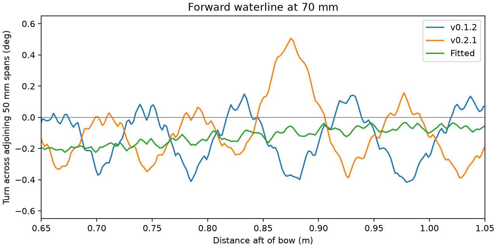

# Whole-hull fairing of Kayak 10.9

The finished hull uses a single fit from keel to sheer and bow to stern. The v0.2.1 forebody had a small knuckle 0.867 m aft of the bow where a girth-dependent section fairing reached its maximum span. At 70 mm above the keel, the line briefly turned outward by 0.506° across adjoining 50 mm spans. The fitted hull keeps turning inward through this interval. Across all the cuts, the largest measured change in turn occurs near the stern on the innermost buttock.



## Geometry and controls

The design net has 441 longitudinal stations and 129 equal-girth samples per half section. The least-squares cubic surface uses ten longitudinal and 22 transverse spans. The fit tapers into the original keel and deck seam across the first and last 12% of half-girth. It retains the stem treatment in the first and last 250 mm and blends over the next 300 mm. One symmetric breadth adjustment constrains the 4-inch beam to 500.456 mm. Output tessellation samples the same net. The outfitted assembly, station DXF and mold builders use these finished rings.

The deck and aft coaming retain their existing geometry. Through the strongly raked bow, finer tessellation moves the exported centreplane outline by up to 0.103 mm in nearest-profile distance. The historical hull JSON describes the input form. Use the finished outer shell for hull measurements.

## What changed

- Nine waterlines, five buttocks, five 45° diagonals and 23 transverse cuts cover the hull. The lines sheet includes normal-based reflection bands. Turn is the signed angle between adjoining 50 mm chords measured along X. The section comb uses a three-point circle with approximately 15 mm spacing along girth. The signed entry metric uses 0.70–1.02 m aft of the bow. The stern sweep still produces tight turns. At the 75 mm buttock its peak change of turn over 50 mm increased from 3.45° to 3.63°.
- At the four earlier forebody test stations, peak transverse curvature change on the finished mesh is approximately 131–194 m⁻². The corresponding v0.2.1 values are 132–203 m⁻² and the v0.1.2 values are 599–724 m⁻². Both directions of the sampled surface-distance comparison are below 0.60 mm. The largest candidate-to-reference distance is 0.598 mm on the forward bilge.
- At 4 inches the finished length and beam are 5442.889 and 500.458 mm. Seawater displacement at that height changes from 125.989 to 125.976 kg. At equal loads of 225, 265 and 300 lb, maximum draft change is 0.009 mm. With KG 250 mm above the keel, righting arms change by at most 0.072 mm at 10°, 20° and 30°. The largest upper-beam change in the 225 lb catch measurements is 0.317 mm.

[Full hull lines and reflections](hull-lines.png) · [Surface displacement map](displacement.png) · [Cut-by-cut readings and STL hashes](fairness.json) · [Mesh-distance readings](deviation.json) · [Load cases and comparison tolerances](controls.json)

## Reproduction

Extract each tagged release's outer-shell STL from its 3D assemblies archive. Keep the two files under separate paths. From the repository root run the following commands in the CAD environment.

```sh
python3 cad/build_finished.py
python3 cad/inspect_fairness.py v0.1.2=old-012.stl v0.2.1=old-021.stl Fitted=build/finished/kayak-10-9-outer-shell.stl --out build/fairness
python3 cad/check_fairing_controls.py old-021.stl build/finished/kayak-10-9-outer-shell.stl
python3 -m unittest discover -s tests -v
```

The load check balances displaced volume and longitudinal moment on the inclined mesh with free trim at heel, seawater density 1025 kg/m³ and zero transverse CG. It clips the upper catch contour at 100 mm above the loaded waterline and measures widths at the upright LCG and 0.8–1.2 m forward in 0.1 m steps. The comparison limits are 1 mm for 4-inch dimensions and loaded draft, 2 mm for catch widths and 0.5 mm for righting arms. The evidence concerns the digital hull.

This run used Python 3.12.3, kayak-gen revision `62b1a9e`, NumPy 2.5.4, SciPy 1.18.1, trimesh 5.2.0, VTK 9.7.2, PyVista 0.49.2, Matplotlib 3.11.2, ezdxf 1.4.4, NetworkX 3.7 and Shapely 2.2.0.
